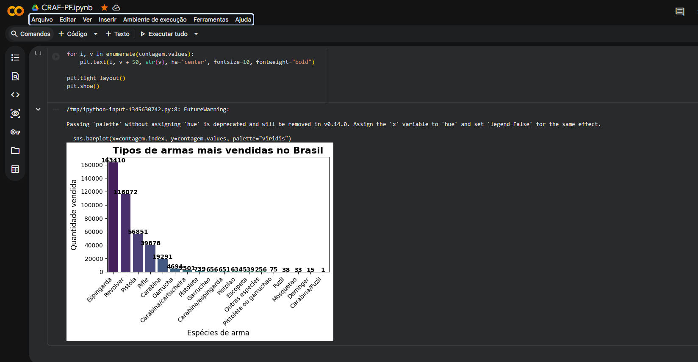
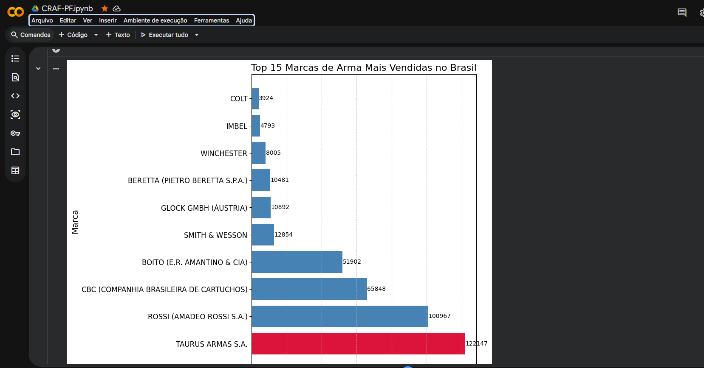

# Big Data Analysis with Python

Projeto de análise de dados desenvolvido em Python utilizando Google Colab.

## 🚀 Tecnologias
- Python
- Pandas
- Matplotlib
- Seaborn
- Google Colab

## 📊 Funcionalidades
- Limpeza de dados
- Análise exploratória
- Criação de gráficos
- Visualização de dados
.
## 📊 Gráficos

